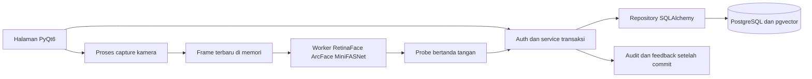

# Arsitektur StarGate

Pembaruan28 Oktober2026. Pengembangan macOS; executable x64 diuji pada Windows11 ARM64 Parallels. Struktur berikut mengikuti implementasi saat ini. Bagian bertanda tahap menjelaskan evolusi sistem, bukan status menu yang masih kosong.

## Jalur startup

`main.py` -> `app.bootstrap.main` -> validasi `app.settings.config` -> logger diagnostik -> ErrorReporter -> theme -> SessionWindow -> bootstrap/login -> MainWindow sesuai role -> event loop Qt.

- Startup menyiapkan engine tanpa koneksi langsung. Restore remember (jika ada marker) dan login mengakses DB di worker. Kamera/AI belum dimuat. Koneksi DB gagal menolak autentikasi dengan pesan aman.
- Default config sesuai PRD; dotenv dibaca tanpa interpolasi/global environment mutation. Override hanya key STARGATE_*; konfigurasi invalid tidak mencetak input. File default hilang boleh memakai baseline; file eksplisit hilang adalah error.
- Startup gagal konfigurasi atau akses folder log memberi pesan aman dan exit 2. `--check-config` dapat dipakai tanpa GUI.
- Secret DB tidak ada dalam repr config. Logger mengetahui secret dari config agar dapat menyaring pesan tak sengaja.

## Struktur dan batas tanggung jawab

| Direktori | Tanggung jawab |
|---|---|
| app/ui | Main window, theme, navigasi; hanya thread GUI mengubah widget |
| app/pages, app/widgets | Halaman dan komponen presentasi |
| app/settings | Config immutable dan validasi |
| app/services | Autentikasi/otorisasi, worker, error, logging; batas transaksi layanan |
| app/repositories, app/models | Model ORM dan repository Tahap 3; otorisasi dipanggil di service |
| app/services/reports.py, app/exports | Snapshot laporan terikat sesi, ekspor seluruh hasil filter ke XLSX/PDF |
| ai/detector, recognizer, liveness, embedding | Tempat adapter AI Tahap 7; tidak dimuat oleh shell |
| database/migrations, schema, seed | Tempat evolusi schema/seed Tahap 3 |
| resources, logs | Resource lokal dan log diagnostik; bobot/log diabaikan Git |
| tests, scripts | Test otomatis dan pemeriksaan lingkungan/fondasi |

Seluruh halaman anggota, grup, shift, perangkat, kehadiran, dashboard, laporan, pengaturan, pengguna, audit dan cadangan telah diimplementasikan. Hak akses diperiksa pada service. Super Admin pertama dibuat melalui halaman bootstrap ketika akun pengelola belum ada; ganti password bersifat opsional.

Resource binary/model/lisensi berada di bundle yang dibaca saja. Config, foto kelolaan, log dan database berada di folder data per pengguna. Installer otomatis menyiapkan PostgreSQL17/pgvector pada koneksi loopback dengan role owner, migrator dan app terpisah. Startup menjalankan pemeriksaan/penyalaan cluster kelolaan melalui worker. Konfigurasi database eksternal tetap memakai pemeliharaan eksplisit.

CameraManager dan worker AI terpisah dari thread GUI. Antrean menyimpan frame terbaru dan backpressure membatasi permintaan. Probe berisi binding sesi/perangkat/revision, sequence, freshness dan signature; service memeriksa kembali otorisasi serta kebijakan sebelum commit. Preview mirror hanya untuk tampilan; jangan menjadikan perubahan preview sebagai perubahan data model.

## Worker lifecycle

- TaskController di thread GUI membuat QObject Worker tanpa parent dan memindahkannya ke QThread.
- Worker menjalankan fungsi dengan TaskContext yang membawa Event pembatalan dan callback progress. Fungsi tidak menerima widget.
- Result/progress/error/cancel dikirim melalui signals/slots. Slot error milik controller mengirim error ke ErrorReporter di thread GUI.
- finished meminta thread quit; thread.finished menjadwalkan worker.deleteLater dan controller membersihkan referensi setelah join nonblocking berhasil.
- Satu controller menerima satu task aktif. Task kedua ditolak, bukan menimpa referensi worker yang masih berjalan.
- Saat close, jendela meminta pembatalan, mengabaikan close sementara dan menunggu settled melalui event loop; tidak memakai terminate atau wait tanpa batas di thread GUI.
- Task harus kooperatif: panggil checkpoint atau pause, dan gunakan timeout pada I/O. Event dapat membatalkan pause dengan segera. Native inference/I/O yang tidak menyediakan cancellation memerlukan timeout atau isolasi proses pada tahap adapter terkait; fondasi ini tidak menjanjikan dapat memutus call native yang macet.

## Error dan privasi log

ErrorReporter menghasilkan nomor referensi dan pesan pengguna yang aman. sys.excepthook memusatkan exception tak tertangani dari callback UI dan dipulihkan pada shutdown. Error worker ditangkap di worker lalu dilaporkan melalui controller.

Rotating file log khusus namespace stargate, tanpa propagation ke root. Pesan menyaring known secrets, credential field, URL RTSP/PostgreSQL dan payload embedding/vector. Trace exception menyimpan jenis, basename file, nomor baris dan fungsi; tidak menyimpan exception message atau source line. Result task tidak otomatis dilog. Ini perlindungan berlapis, bukan izin untuk menulis data wajah ke logger.

## Referensi dokumentasi

MCP Context7 resolve PyQt6 -> `/websites/riverbankcomputing_static_pyqt6`; query memverifikasi worker object, moveToThread, queued signal/slot, finished/deleteLater dan requestInterruption. Sumber: [QThread](https://www.riverbankcomputing.com/static/Docs/PyQt6/api/qtcore/qthread.html), [QObject.deleteLater](https://www.riverbankcomputing.com/static/Docs/PyQt6/api/qtcore/qobject.html). Penerapan diverifikasi dengan test Qt offscreen dan jendela native; tidak menambah dependensi.

## Batas autentikasi

SessionWindow mengoordinasi login, forced change, logout, timeout, restore dan formulir pengguna. Jobs membungkus TaskController; expected errors menjadi pesan aman, unexpected errors melewati ErrorReporter. Callback hasil baru dijalankan setelah thread settled; operasi transaksi tidak dibatalkan separuh ketika menutup aplikasi.

AuthService membuat transaction/session baru per operasi. Layanan menegakkan izin pada setiap operasi, menggunakan role terkini di DB; principal yang dibawa UI hanya untuk tampilan. MainWindow wajib menerima principal dan guard navigasi. Entry point produksi selalu melalui SessionWindow; smoke fondasi memakai double sintetis eksplisit dan tidak mengakses data bisnis.

Token interaktif dan remember dipisah di auth_sessions; hanya hash disimpan. Event filter hanya menandai input key/mouse/wheel/touch pada jendela aplikasi; timer satu detik memeriksa sesi di worker. Validasi memeriksa batas idle sebelum memperpanjang aktivitas, sehingga input setelah batas tidak menghidupkan sesi kedaluwarsa. DB tidak tersedia saat pemeriksaan sesi menutup konten terlindungi.

CredentialStore hanya menerima native Keychain/Credential Manager; marker kosong mode 0600 menandai pernah menyimpan token dan menghindari pembukaan Keychain pada instalasi baru. Marker tidak memuat token. Scope didasarkan host/port/database/user. Logout tetap menghapus marker bila OS sedang menolak akses; token yang berhasil dicabut di server tidak dapat dipakai lagi.

Percobaan login gagal dan penolakan izin dikomit bersama audit sebelum error dikembalikan. Tidak ada password/token/username yang dikirim ke logger diagnostik. Audit referensi user ID dan kode event; akun tak dikenal dicatat tanpa input username bebas. Tidak ada raw SQL data bisnis di layanan.

## Administrasi dan demo Tahap 5

AdministrationService mengeksekusi mutasi melalui transaction/otorisasi AuthService yang sama. DTO immutable dipakai UI, tidak ada ORM Session yang dibagi antarthread. Revision counters mencegah stale update; audit ditulis dalam transaksi mutasi. Group yang direferensikan member/attendance dan shift yang direferensikan assignment/attendance dilindungi dari delete.

Jobs membedakan aktivitas interaktif dan polling. Poll tidak mengubah enabled state input; satu aksi interaktif yang datang saat poll berjalan diantrekan, tanpa duplikasi. Jika validasi sesi gagal, antrean dibuang sebelum diproses. AdminPage menunda query sampai worker tersedia, menahan tombol saat mutasi, dan mempertahankan input pencarian saat loading. Konfirmasi memakai dialog open/finished, bukan nested exec pada callback worker.

PhotoStore membaca input bounded, memverifikasi PNG/JPEG dan dimensi, menulis salinan privat PNG. File baru dikeluarkan jika transaksi gagal; foto lama tidak otomatis dihapus. Ini foto profil, bukan face detection/enrollment. Gate registrasi baru tetap di service dan UI.

Demo menggunakan database/demo.py dan scripts/demo_administration.py, hanya stargate_test/schema unik. Akun/sesi demo tetap melewati auth yang sama; tidak memasang bypass pada main.py, tidak menyimpan remember ke OS, dan tidak memasukkan contoh ke development. Foto bidang warna dan history sintetis disiapkan sebagai fixture eksplisit, lalu dibersihkan setelah event loop berhenti normal.

## Perangkat dan kamera Tahap 6

DevicesService menerapkan izin devices (Super Admin/Admin), validasi, revision dan audit dalam transaksi yang sama. DevicesPage mengakses layanan melalui Jobs; daftar perangkat tidak otomatis membuka kamera. Sumber RTSP lengkap tersimpan di native Keychain/Credential Manager melalui DeviceSecretStore. Database hanya memuat host/port tampilan dan reference acak; URL dengan user/password/path/query tidak dipulihkan ke formulir maupun log. OS vault yang tidak tersedia menolak penyimpanan RTSP, tanpa fallback plaintext.

CameraManager menjalankan satu proses spawn per kamera; UI Qt tidak melakukan read kamera. OpenCV memakai AVFoundation di macOS, DirectShow di Windows dan FFmpeg untuk RTSP. Timeout RTSP diberikan sebagai parameter open-only saat open. Parent juga mengawasi open/read; proses capture miliknya dapat dihentikan bila native read macet. Retry RTSP dibatasi konfigurasi, bukan loop tanpa akhir. Webcam lokal tidak dibuka ulang otomatis setelah gagal karena index dapat beralih ke perangkat lain; pengguna memeriksa nomor dan mulai manual. Stop normal memberi kesempatan release lalu terminate/kill terbatas bila perlu; thread database tidak dihentikan paksa.

Setiap kamera memiliki satu slot RGB terbaru maksimal 960×540×3 byte, metadata dan lock singkat. Frame baru mengganti frame lama, tidak membuat antrean video. UI menerima salinan QImage dan membersihkan gambar berumur lebih dari satu detik. Test connection berhenti setelah satu frame. Keluar halaman, ganti password, logout, sesi berakhir dan close meminta penghentian seluruh capture. Tidak ada frame disimpan ke berkas; ini belum pipeline AI/absensi Tahap 7–10.

Dokumentasi OpenCV diperiksa melalui MCP Context7: [FFmpeg open-only timeout](https://github.com/opencv/opencv/blob/5.x/modules/videoio/src/cap_ffmpeg_impl.hpp), [pemilihan backend](https://github.com/opencv/opencv/blob/5.x/modules/videoio/src/cap.cpp), [capture/release](https://github.com/opencv/opencv/blob/5.x/doc/py_tutorials/py_gui/py_video_display/py_video_display.markdown). Dokumentasi upstream 5.x menjadi rujukan API; runtime proyek tetap 4.11.0 dan diuji langsung pada perangkat yang tersedia. Dukungan Windows memerlukan pengujian di Windows pada Tahap 14.

## Engine AI dan alat uji Tahap 7

ai.engine.FaceEngine menggabungkan adapter RetinaFace, 106-landmark/ArcFace dan MiniFASNet; ai.contracts menentukan input BGR uint8, opsi tervalidasi dan hasil privat. Startup model memverifikasi manifest/checksum dahulu. get_model dipanggil untuk dua ONNX tertentu, bukan FaceAnalysis yang memuat detektor otomatis. Semua model CPU dan satu permintaan inference aktif per worker; tidak membagi instance DNN/ONNX/PyTorch antarthread.

ai.embedding.search memakai unit_embedding yang sama untuk cosine lokal dan query pgvector melalui EmbeddingRepository. Model version mengikat fitur yang kompatibel; query hanya anggota/embedding aktif dan tidak mencampur versi. Menyimpan referensi sementara di lab bukan enrollment; API administrasi registrasi anggota tetap diblokir sampai Tahap 8.

InferenceController di thread GUI hanya mengisi satu slot shared-memory dan mengirim perintah kecil ke proses spawn yang persisten. Model dimuat sekali selama sesi, frame disalin privat sebelum inference dan slot dibersihkan. Hasil IPC hanya status, bbox/titik untuk panduan, skor dan status kecocokan; embedding referensi tetap di proses. Parent menolak hasil setelah deadline, termasuk yang sudah menunggu di pipe, kemudian terminate/kill hanya proses miliknya dengan cleanup nonblocking. Native call yang terblokir tidak membekukan GUI. Deadline cold loading 30 detik terpisah dari recognition 3 detik.

scripts/demo_ai.py membuka app.ui.ai_lab.AiLab, alat uji opt-in tanpa database/login/enrollment/attendance. CameraManager yang sama dipakai untuk pengambilan frame; pratinjau menggunakan salinan dengan overlay, input inference tetap gambar asli tanpa overlay. Consent dicabut/stop/close membuang referensi dan menghentikan kamera/model. Alat mencatat trial scalar hanya di memori; tidak menulis foto/embedding atau mencatat absensi. scripts/check_ai.py adalah smoke numerik opt-in; output scalar tidak menandai keaslian/akurasi lulus dari keberhasilan transport.

## Registrasi dan retensi Tahap 8

MembersPage membuka EnrollmentDialog window-modal secara nonblocking setelah EnrollmentService.begin memeriksa sesi/member/revision/metadata. CaptureLab memakai CameraManager dan InferenceController yang sama, dengan EnrollmentTarget khusus; liveness capture dipaksa aktif/.85. Sampel yang belum lengkap hanya di proses anak. CaptureDraft mengharuskan lima pose berurutan dengan rasio landmark relatif terhadap depan dan guard cosine identitas; ambangnya heuristik awal, bukan estimasi 3D terkalibrasi.

Set lengkap dikirim sekali sebagai CapturePacket privat berisi PNG depan dan lima vector, HMAC-SHA256 dengan key acak per coordinator, serta binding token-hash/nonce/member/revision/freshness. Tidak memakai argv/file sementara untuk key atau draft. Validasi/izin dilakukan kembali saat save. Profile diimpor privat, anggota dan set vector/audit dikomit atomik; gagal SQL membersihkan file baru, sementara set lama tetap berlaku. Post-commit cleanup memeriksa reference di bawah lock transaksi auth yang sama sehingga foto yang masih dipakai tidak terhapus. Cleanup file yang gagal ditampilkan sebagai pending dan dicoba kembali saat daftar anggota dibaca.

Uji wajah tersimpan memakai purpose verification, bukan enrollment. Satu probe lolos kualitas/liveness dikirim sebagai packet privat bertanda tangan tanpa foto, lalu server melakukan query gallery aktif dan mengecek anggota terpilih. Tidak menyimpan probe atau attendance. Flow/packet tidak dapat dipakai ulang setelah operasi selesai; restart membuat key/flow baru tetapi gallery PostgreSQL tetap dapat dibaca.

Nonaktif anggota menghapus embedding dalam transaksi, mengganti photo_path dengan placeholder dan mempertahankan attendance/audit. Menambahkan foto baru ke anggota nonaktif ditolak di UI/service; edit metadata tanpa biometrik tetap diperbolehkan. Backup/WAL/OS snapshot tidak diklaim secure-erased. Kebijakan dan dasar sumber ada di biometric-retention.md.

## Konfigurasi aktif Tahap 9

SettingsPage memakai Jobs nonblocking, tanpa polling ulang nilai form. SettingsService memeriksa permission settings pada read/save, memvalidasi delapan parameter, mengunci baris berurutan, membandingkan snapshot expected dan menyimpan batch beserta audit dalam satu transaksi. Error/conflict mempertahankan isian. Muat ulang merupakan tindakan eksplisit; pemeriksaan sesi tidak mereset field/fokus.

EnrollmentService.begin membaca snapshot settings valid pada transaksi auth/members yang sama; Operator dapat memakai konfigurasi untuk pemeriksaan anggota meskipun tidak boleh mengedit pengaturan. Binding privat disalin mendalam untuk mencegah mutasi dari caller. EnrollmentDialog membuat AppConfig/EngineOptions immutable dari snapshot. EnrollmentTarget memakai pilihan ini untuk verification, dengan pengecualian liveness aktif/.85 pada registrasi. EnrollmentService.verify mengambil threshold dari snapshot bertanda tangan yang sama. Runtime tidak mengganti opsi worker aktif setelah admin menyimpan perubahan. Tidak ada cache lintas proses yang harus disinkronkan; pemeriksaan baru membaca database lagi.

Duplicate window/check-in start/auto checkout tersedia dalam configured AppConfig untuk konsumsi pipeline absensi Tahap 10. Belum ada penjadwal checkout atau pencatatan attendance pada Tahap 9.

## Absensi Tahap 10

AttendancePage memiliki node inference terpisah untuk tiap kamera terpilih, memakai CameraManager yang sama. Setiap node hanya menyimpan frame/packet terbaru dan satu permintaan inferensi aktif; operasi database mengikuti Jobs dengan backpressure, tanpa antrean video tidak terbatas. Peserta menyetujui pemrosesan sebelum kamera dimulai. AttendanceTarget menjalankan engine purpose recognition dan hanya menandatangani probe dari status ready; metadata kegagalan tidak membawa embedding. Tidak membuat referensi wajah permanen atau file dari scan.

AttendanceService mengikat flow pada token hash, nonce, perangkat/revision, lokasi/timezone, mode dan policy revision. Signature HMAC, sequence, usia hasil, model version, normalisasi/liveness dicek sebelum query pgvector. SettingsService.read_policy menyertakan updated_at untuk mendeteksi perubahan bolak-balik. Auth transaction advisory lock lintas proses yang sudah ada serta row lock anggota/settings menyerialisasi validasi state/cooldown/insert/audit; indeks unik IN/OUT tetap menjadi pertahanan database. Perubahan policy/perangkat membatalkan hasil dan memerlukan mulai ulang, bukan hot swap opsi pada hasil lama.

Tanggal kerja berasal dari awal shift di zona lokasi. State machine dan sesi IN terbuka memisahkan cooldown dari validitas event. Auto checkout menjalankan correlated NOT EXISTS OUT dan query due dengan batas 100, timestamp akhir shift UTC dan sumber otomatis; scheduler nonblocking di SessionWindow hanya selama sesi aktif, dengan catch-up setelah login. Data attendance/audit tidak dihapus ketika anggota nonaktif.

SessionWindow menghentikan attendance ketika berpindah halaman, membuka enrollment, ganti password, logout, timeout dan close. Shell yang disembunyikan ditahan sampai node model/kamera selesai, lalu dihapus; proses tidak kehilangan timer cleanup saat widget dilepas. Suara QSoundEffect dan pesan sukses hanya setelah hasil transaksi berhasil diterima GUI. Pengujian suara memakai stub yang memeriksa row committed; speaker fisik tetap UAT.

## Dashboard Tahap 11

DashboardService memvalidasi permission dashboard melalui AuthService pada setiap snapshot. Query agregat memakai distinct member untuk ringkasan/harian, distinct (member, work_date) untuk hari-kehadiran bulanan, dan hanya IN untuk chart; feed terpisah berisi seluruh event committed (maksimal 20). Shift/grup maksimal 12 teratas, tren 30 hari/12 bulan. Tidak membaca gallery, foto, URL RTSP atau token untuk ditampilkan. Batas transaksi/advisory lock yang sama menyerialisasi snapshot dengan seluruh penulis resmi aplikasi lintas terminal.

DashboardPage memiliki TaskController terpisah dan polling 2 detik hanya selama terlihat. Maksimal satu permintaan berjalan; generation/token/tanggal mencegah hasil lama diterapkan setelah filter/navigasi/logout. Polling tidak menyentuh sesi idle, memulai kamera/inference, atau memuat ulang form. Kegagalan sumber ditandai belum diperbarui; penolakan otorisasi mengosongkan data. Worker diselesaikan sebelum shell lama dihapus/ditutup memakai mekanisme retirement yang sudah tersedia. AttendanceChart menggunakan QPainter pada paintEvent dan update(), bukan library plotting baru.

Tanggal dashboard adalah tanggal kerja; ringkasan shift malam tetap pada tanggal awal shift. Penugasan tanpa IN dihitung lewat zona organisasi dan kalender LOCAL pada topologi satu lokasi. Hadir historis tetap ada setelah anggota nonaktif; total aktif adalah kondisi anggota saat query. Riwayat versi penugasan/izin tidak direkonstruksi. Detail definisi, demo dan batas: testing/stage-11.md. Tidak ada migrasi/dependensi baru.

## Laporan dan ekspor Tahap 12

ReportsService membangun union kunci jadwal aktif/hari kerja dan event tersimpan pada rentang inklusif; hasil per member/shift/work_date menyertakan IN/OUT dan seluruh break. Grup historis diambil dari IN, sedangkan baris tanpa IN memakai sumber penugasan/izin/kalender LOCAL saat query. Tidak mengarang event untuk Absent/Izin/Belum masuk. Kasus konflik ditandai perlu diperiksa. Filter status diterapkan setelah derivasi; kandidat/event dibatasi eksplisit agar tidak mengekspor hasil terpotong sebagai sukses.

Snapshot DTO immutable disimpan privat maksimal dua hasil/15 menit, terikat hash token. ReportsPage memakai TaskController sendiri, pagination lokal 50 baris dan pemuatan eksplisit. Filter berubah membatalkan hasil untuk ekspor. Ekspor memuat seluruh snapshot, bukan halaman aktif ataupun query baru yang dapat menyisipkan scan setelah waktu pemuatan. Permission reports divalidasi di pemuatan, pengambilan snapshot dan publikasi file. Viewer tetap hanya Reports; data gallery/credential tidak dibaca untuk ekspor.

Pandas/OpenPyXL menulis ringkasan dan detail event dengan tanggal bertipe, teks literal, metadata dan table filter. ReportLab menulis PDF landscape dengan Paragraph/LongTable, header berulang dan footer. Baris normal tidak dipotong lintas halaman; hanya baris yang lebih tinggi dari area halaman membutuhkan continuation. Nama Unicode didukung sejauh font yang tersedia; karakter tak didukung gagal eksplisit dengan saran Excel. Alat QA artifact/Poppler tidak menjadi dependency runtime aplikasi.

File sementara privat dibuat pada folder tujuan, dibersihkan saat gagal/batal dan dipublikasikan atomik setelah revalidasi sesi/snapshot. TaskContext.commit menetapkan batas publikasi: cancel sebelum aksi dicek, cancel yang datang ketika aksi sudah selesai tidak membuat UI melaporkan batal palsu. Logout/navigasi/close membatalkan pekerjaan dan menunggu worker selesai; cache dibersihkan saat shell diganti. Detail, batas filesystem/font dan demo: testing/stage-12.md.

## Audit dan pemulihan Tahap 13

AuditService menyediakan DTO read-only terotorisasi SA/Admin. BackupService + backup_codec membentuk data-only JSON berstruktur tetap, AES-GCM/Scrypt, verifikasi schema/aset dan publikasi tanpa overwrite. BackupsPage memakai worker terpisah, inspeksi/digest dan konfirmasi ketik; SessionWindow menghentikan kamera/AI dan polling ketika restore. database.maintenance memberikan owner capability hanya untuk target terkonfigurasi; AppConfig/akun runtime tidak mendapat kredensial/izin DDL. Restore membuat pengaman lalu mengganti data dalam transaksi dengan lock bersama penulis resmi serta lock tabel eksklusif. Biometrik/sesi dilewati sesuai keputusan pengguna. Paket ini memulihkan data pada schema yang sudah dimigrasi, bukan cluster/OS; provisioning Windows tetap Tahap 14.
