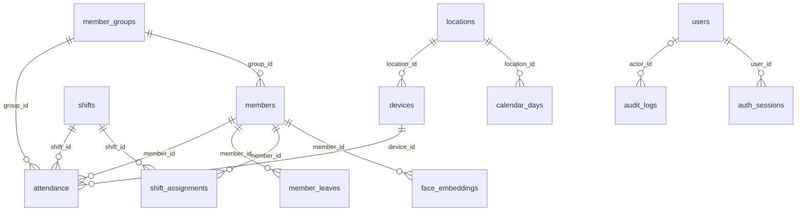

# Database StarGate - Tahap 3

Tanggal: 18 Oktober 2026. Revision awal: `0001_stargate`.

Pembaruan28 Oktober2026: schema produksi kandidat0.14.2 adalah `0006_search_storage`; penggantian password opsional sudah diterapkan melalui0005. Catatan per tahap di bawah adalah riwayat implementasi. Foto/embedding yang dihapus tidak dikembalikan saat restore; akun dan riwayat dipulihkan sesuai kebijakan cadangan7hari. Setup database otomatis dijelaskan pada [panduan Windows](windows-auto-setup.md).

## Relasi aktual

Diagram berikut diperiksa terhadap foreign key model ORM. `settings` berdiri sendiri; audit boleh mempunyai aktor kosong untuk kegiatan sistem.

## Delapan tabel inti sesuai PRD

Kolom PRD dipertahankan. Tipe/constraint dan kolom pendukung menjadikan relasi dan riwayat konsisten.

| Tabel | Kolom dari PRD | Tambahan / batas |
|---|---|---|
| members | id, member_code, full_name, group_id, email, phone, position, photo_path, is_active, created_at, updated_at | Code unik case-insensitive; nama/code/photo wajib; group FK RESTRICT; hard delete ditolak bagi app role |
| member_groups | id, group_name, description, created_at | Nama unik case-insensitive; referensi member/attendance tidak boleh diputus |
| face_embeddings | id, member_id, embedding vector(512), created_at | angle, model_version, is_active; FK member RESTRICT; repository memvalidasi finite/nonzero dan normalisasi |
| shifts | id, shift_name, start_time, end_time, grace_minutes | Grace 0..1439; jam sama ditolak; jam akhir sebelum awal diperbolehkan untuk shift malam |
| attendance | id, member_id, device_id, shift_id, attendance_type, attendance_time, status | work_date, group_id snapshot, is_early_leave, is_automatic, created_at; unique parsial satu IN/OUT per member/shift/tanggal kerja |
| devices | id, device_name, device_type, rtsp_url, resolution, fps | location_id, created_at; tipe INTERNAL/USB/RTSP; fps 1..240 |
| users | id, username, password_hash, fullname, role, last_login | is_active, must_change_password, created_at; username unik case-insensitive; bcrypt prefix/length constraint; app tidak boleh hard delete |
| settings | id, setting_key, setting_value | JSONB typed, created_at, updated_at; key unik; validasi repository membatasi key/nilai yang dikenal |

## Lima tabel pendukung yang mengikuti keputusan kebutuhan

| Tabel | Isi | Alasan |
|---|---|---|
| audit_logs | actor_id, action, entity_type/id, details JSONB, created_at | Kebutuhan audit PRD/US-029; actor FK mempertahankan atribusi |
| shift_assignments | member_id, shift_id, starts_on, ends_on | Penugasan shift bertanggal; range divalidasi; overlap/kebijakan penugasan diselesaikan pada Tahap 5 |
| member_leaves | member_id, starts_on, ends_on, leave_type | Sumber status izin untuk dashboard; bukan event absensi |
| calendar_days | location_id, calendar_date, is_workday, label | Override hari kerja/libur per lokasi; kalender mingguan dan penghitungan Absent belum diaktifkan |
| locations | location_code, location_name, timezone, is_active | Label lokasi; seed LOCAL. Deployment awal tetap satu komputer lokal, tanpa cloud sync |

Seluruh tabel ber-ID menggunakan BigInteger Identity. Tabel pendukung juga mempunyai created_at; lokasi mempunyai updated_at. Semua FK memakai RESTRICT, bukan cascade penghapusan data historis. ORM relationship member-group/embedding dapat dibaca, tetapi tidak mengaktifkan delete-orphan.

`attendance.status` saat ini PRESENT/LATE; early leave flag terpisah. Absent/On Leave akan dihitung dari jadwal/kalender/izin pada Tahap 11, bukan diisi sebagai hasil scan palsu. Work date disediakan eksplisit; derivasi shift malam, cooldown dan state absensi tetap Tahap 10. Pengindeksan IN/OUT tidak menggantikan validasi cooldown/state.

Tahap 11 kini menghitung Absent/Izin/Belum masuk dari penugasan aktif, izin dan kalender LOCAL saat query; tidak menulis event palsu atau status baru pada attendance. Hadir/terlambat serta grafik berasal dari IN committed dengan deduplikasi orang/tanggal. Sumber grup chart adalah group_id historis attendance. Statistik historis jadwal/izin mengikuti data yang tersedia, karena tabel belum menyimpan riwayat versi lengkap. Schema tetap 0004_devices, tanpa migrasi Tahap 11.

Tahap 12 membaca jadwal dan event dengan SQLAlchemy untuk laporan per anggota/shift/tanggal kerja. Snapshot laporan hanya di memori, terikat sesi; file Excel/PDF dibuat dari snapshot yang sama tanpa tabel ekspor, tanpa perubahan schema dan tanpa penulisan absensi hasil inferensi Absent/Izin. Sumber grup saat IN dipertahankan, nama/label lain mengikuti data saat laporan dimuat. Halaman 50 baris tidak membatasi ekspor seluruh snapshot. Audit lengkap/export/backup tetap ditinjau pada Tahap 13; laporan tidak mengakses foto/embedding atau URL RTSP.

## Akun dan transaksi

- `stargate_migrator`: pemilik schema/tabel untuk migrasi, terpisah dari runtime aplikasi.
- `stargate_app`: tanpa superuser/createdb/createrole atau CREATE tabel permanen; dapat DML sesuai grant.
- Audit: SELECT/INSERT saja. Members/Users: SELECT/INSERT/UPDATE, tanpa DELETE. Revision metadata: SELECT saja. Tabel lain DML normal dalam batas FK/constraint.
- Administrator database/migrator tetap berwenang mengubah schema/data; audit bukan bukti kebal terhadap administrator database.
- Database.transaction memakai sessionmaker.begin: commit setelah seluruh operasi termasuk audit berhasil, rollback semua saat ada exception. Repository melakukan flush tetapi tidak commit sendiri.
- Session tidak dibagi antar-thread; tiap operasi memakai session sendiri. Connection pool pre-ping, timeout koneksi 3s, statement 10s, lock 3s; waktu koneksi UTC, tampilan mengikuti zona organisasi.
- Kegagalan koneksi/constraint mengembalikan exception aplikasi dengan pesan aman. SQLAlchemy hide_parameters aktif; jangan mencetak exception DB mentah atau URL/password.

## Migrasi dan schema health

Revision Alembic berisi DDL statis, tidak mengimpor metadata ORM hidup untuk create/drop. Extension pgvector disiapkan akun provisioning Tahap 1; migrator tidak dinaikkan menjadi superuser. Hak app, termasuk audit append-only dan revision read-only, diterapkan pada transaksi migrasi.

Gunakan scripts/manage_database.py, bukan URL rahasia dalam alembic.ini. `status`/`check` memeriksa revision, tabel dan kolom pada schema yang ditentukan secara eksplisit, tanpa fallback public. Test integrasi juga membandingkan metadata/tipe/index/constraint dengan ORM.

Downgrade diuji hanya dalam schema sementara. CLI tidak menyediakan shortcut downgrade/reset/drop untuk data operasional. Perubahan schema selanjutnya harus revision baru; jangan mengedit revision 0001 yang sudah diterapkan.

## Seed dan Super Admin

Seed menciptakan 12 nilai awal dan satu lokasi LOCAL; ON CONFLICT DO NOTHING tidak menimpa konfigurasi yang pernah diubah. Seed kedua tidak menambah audit palsu. Delapan parameter PRD: .60, Auto, 3s, anti-spoof true/.85, duplicate 60s, check-in Shift, auto checkout false. Tambahan baseline: Asia/Jakarta, idle 15 menit, lockout 5 kali/15 menit.

Tidak ada akun default atau password bawaan. Bootstrap Super Admin interaktif menerima password lewat getpass (12..72 byte UTF-8), menyimpan bcrypt cost 12 dan must_change_password. Advisory lock transaksi mencegah dua bootstrap menghasilkan dua admin awal. Akun aktif yang sudah ada tidak ditimpa. Login/change-password UI dibangun Tahap 4.

## Audit dan data sensitif

Audit hanya menyimpan kode aksi/entitas/actor dan detail whitelist: field yang berubah, jumlah record, jenis event, serta nilai lama/baru pengaturan nonsensitif yang dikenal. Tidak menerima arbitrary payload, password, foto, embedding atau URL RTSP. Audit append-only ditegakkan juga melalui grant database aplikasi.

Kolom rtsp_url dipertahankan untuk kesesuaian PRD, tetapi repository Tahap 3 tidak menerima credential-bearing URL. Penyimpanan kredensial perangkat diselesaikan sebelum Tahap 6. Tidak ada foto/embedding nyata pada dev/test saat penutupan tahap; retensi data nyata harus ditetapkan sebelum Tahap 7.

## Referensi dokumentasi

MCP Context7: `/websites/sqlalchemy_en_20` untuk sessionmaker.begin/rollback, `/websites/alembic_sqlalchemy` untuk programmatic connection dan migrasi, `/pgvector/pgvector-python` untuk VECTOR(512)/cosine_distance.

Sumber: [SQLAlchemy sessions](https://docs.sqlalchemy.org/en/20/orm/session_basics.html), [Alembic cookbook](https://alembic.sqlalchemy.org/en/latest/cookbook.html), [pgvector SQLAlchemy](https://github.com/pgvector/pgvector-python#sqlalchemy).

## Tambahan Tahap 4 — revision 0002_auth

Migrasi baru menambahkan users.failed_attempts dan locked_until, serta auth_sessions (14 tabel aplikasi total). Kolom sesi: user_id, token_hash unik SHA-256, is_remember, last_activity, expires_at, revoked, id/created_at. Aplikasi hanya SELECT/INSERT/UPDATE pada tabel token; migrator tetap terpisah. Revision 0001 tidak diedit.

Login benar memperbarui last_login; gagal memperbarui counter dan audit dalam transaksi yang tetap dikomit. Pada implementasi Tahap4, akun bootstrap/baru/reset diwajibkan mengganti password. Revisi pengguna dan migrasi0005 membatalkan kewajiban tersebut untuk seluruh akun; reset/change/nonaktif/perubahan peran tetap mencabut sesi. Histori akun dipertahankan. Pengaturan auth yang disemai tetap 15 menit idle, 5 kegagalan, 15 menit lockout.

Tabel sesi menyimpan hash, bukan password/token mentah. Rows yang dicabut tetap tersedia untuk diagnosa tahap ini; pembersihan/retensi ditetapkan sebelum operasi data nyata. Audit event auth menggunakan entity_type=user dan user ID jika diketahui. UI Users hanya Super Admin melalui AuthService, repository internal bukan API untuk dipanggil langsung oleh UI.

## Tambahan Tahap 5 — revision 0003_admin

member_groups/members/shifts mendapat revision integer default 1. Update administratif yang mengubah data meningkatkan revision; form mengirim revision terakhir dan stale edits ditolak. Nomor ini guard layanan, bukan trigger untuk setiap penulis SQL eksternal. Tabel tetap 14; migration baru tidak menghapus row atau mengganti password/token yang sudah ada.

Assignment memakai starts_on/ends_on inklusif terhadap tanggal kerja. Layanan menolak overlap, tanggal terbalik, anggota nonaktif dan pemendekan rentang yang mengeluarkan attendance tersimpan. Lock transaksi auth dan row lock melindungi pemeriksaan/perubahan bersamaan. Jam/grace shift yang sudah direferensikan tidak diubah; shift baru dipakai untuk jadwal pengganti. Audit menyimpan field yang berubah, tanpa foto/email/telepon mentah.

Riwayat anggota menggunakan group_id snapshot dari attendance, sehingga perpindahan grup tidak mengganti klasifikasi historis. UI menampilkan total dan 50 event terbaru; penyimpanan event nyata tetap Tahap 10. Demo hanya schema unik di database test; public/development bukan tempat seed contoh.

## Tambahan Tahap 6 — revision 0004_devices

Devices menambah camera_index nullable (lokal 0–15 pada layanan), secret_ref unik nullable, revision default 1. Pada RTSP camera_index NULL dipertahankan eksplisit; update tanpa perubahan tidak menaikkan revision. Resolusi layanan: 640×480, 1280×720, 1920×1080; FPS 1–60 walaupun constraint database lama lebih longgar. Device yang sudah direferensikan attendance tidak dapat dihapus.

rtsp_url kini hanya host/port tersanitasi. URL lengkap, termasuk path/query, hanya di native vault dengan reference acak. Transaksi gagal membersihkan secret baru; mengganti sumber/menghapus perangkat membersihkan reference lama setelah commit. Jika vault menolak penghapusan, item lama yang tidak direferensikan dapat tertinggal; tidak ada fallback ke berkas. Backup database saja belum memulihkan kredensial RTSP; prosedur provisioning/restore vault harus diselesaikan pada Tahap 13.

Migrasi dev/test diverifikasi dengan perbandingan semua kolom lama dan seluruh row sebelum/sesudah di memori, tanpa menulis password/hash/sesi ke laporan. Bukti: testing/evidence/stage-06-deployment.json.

## Registrasi Tahap 8 — tanpa migrasi

Schema tetap 0004_devices. EnrollmentService menyimpan Member dan lima FaceEmbedding dengan versi model sama beserta audit pada satu transaksi AuthService; re-register menghapus set lama dan memasukkan set baru sebelum commit, dengan stale revision guard. Tidak menyimpan foto mentah lima sudut/video. Foto profil PNG adalah aset privat, dikompensasi bila SQL gagal dan dibersihkan sebagai orphan setelah crash ketika daftar anggota dimuat.

Retensi sekarang diputuskan atas mandat pengguna: anggota aktif menyimpan profil/lima vector selama diperlukan; nonaktif menghapus embedding dan mengganti photo_path dengan placeholder, attendance/audit tetap. Ini mengubah kebijakan sementara Tahap 5 yang mempertahankan embedding saat nonaktif. Tidak mengubah perilaku referensi historis Member/Attendance, tidak hard-delete anggota/user dan tidak menghapus foto sumber eksternal. Lihat biometric-retention.md untuk sumber resmi serta batas backup/restore.

## Pengaturan Tahap 9

Tidak ada migrasi baru: revision tetap 0004_devices. Delapan key pengenalan/anti-spoof/absensi memakai tabel settings JSONB dan seed yang sudah ada. SettingsService menolak key tak dikenal, nilai tidak valid atau set tidak lengkap. Simpan batch/audit atomik dan row lock berurutan; expected snapshot mencegah overwrite admin lain tanpa pemberitahuan. Perubahan nilai efektif untuk flow baru, bukan worker yang sudah berjalan. Tidak menulis data contoh atau pengaturan uji ke stargate_dev.

## Absensi Tahap 10

Revision tetap 0004_devices, tanpa perubahan skema. AttendanceService memakai kolom/event/index yang sudah tersedia, memeriksa state dan cooldown lintas kamera pada transaksi yang dilindungi lock auth serta row lock anggota/settings. Audit attendance.recorded memuat aktor, event_type dan penanda field otomatis tanpa probe biometrik. Status keterlambatan dan group sesi IN dipertahankan saat checkout otomatis; history memakai is_automatic. Query due dibatasi 100 baris dan hanya IN tanpa OUT untuk shift/tanggal kerja yang sama. Timestamp event otomatis adalah akhir shift, created_at/audit adalah waktu pencatatan/catch-up.

Settings policy fingerprint menambah updated_at pada pembacaan runtime, bukan kolom baru. Replay/expired probe ditolak; tidak menyimpan vector baru dari attendance. Transaksi masih dapat berstatus tidak terkonfirmasi jika koneksi terputus ketika acknowledgement commit; tidak memberi suara/pesan sukses tanpa konfirmasi, dan riwayat perlu diperiksa sebelum mencoba scan lagi. Tidak mengklaim penghapusan WAL/backup dari retensi biometrik.

## Pemulihan data Tahap 13

Tidak ada migrasi schema baru. Backup menyimpan data logis tabel aplikasi dan aset foto kelolaan dalam bundel terenkripsi, tanpa sesi dan referensi rahasia RTSP. Restore memakai akun owner melalui helper administrasi yang memvalidasi target, lock advisory+tabel, backup pengaman, DELETE/INSERT berparameter dan restart identity transaksional. Akun runtime tetap tidak berhak mengubah/menghapus audit atau melakukan DDL. Metadata/schema harus cocok; arsip tidak membawa SQL yang dijalankan. Sesuai persetujuan pengguna, foto menjadi placeholder dan embedding/sesi tidak dipulihkan. Audit sebelum snapshot pulih, event restore ditambah; audit sesudah snapshot tersedia di pengaman. [Prosedur, retensi 7 hari dan batas](testing/stage-13.md).

## Penyimpanan exact search (0006)

Migrasi `0006_search_storage` mempertahankan embedding512D bertipe float32 dan query cosine exact. Kolom embedding memakai STORAGE PLAIN dengan `toast_tuple_target=4096`; migrasi menulis ulang nilai lama agar embedding dan metadata kecil tidak dibaca melalui TOAST per baris. Transaksi memakai advisory lock dan batas waktu120detik. Tes migrasi memeriksa byte vektor, pose, model dan status aktif sebelum/sesudah. Sediakan ruang disk untuk penulisan ulang dan jalankan saat pemeliharaan.

Pencarian satu hasil mengambil sampel aktif terdekat dengan tie-break ID anggota, yang setara dengan mengambil anggota dengan jarak minimum terbaik. Pencarian banyak hasil tetap mengelompokkan setiap anggota. Tidak ada indeks approximate baru atau perubahan ambang similarity.
